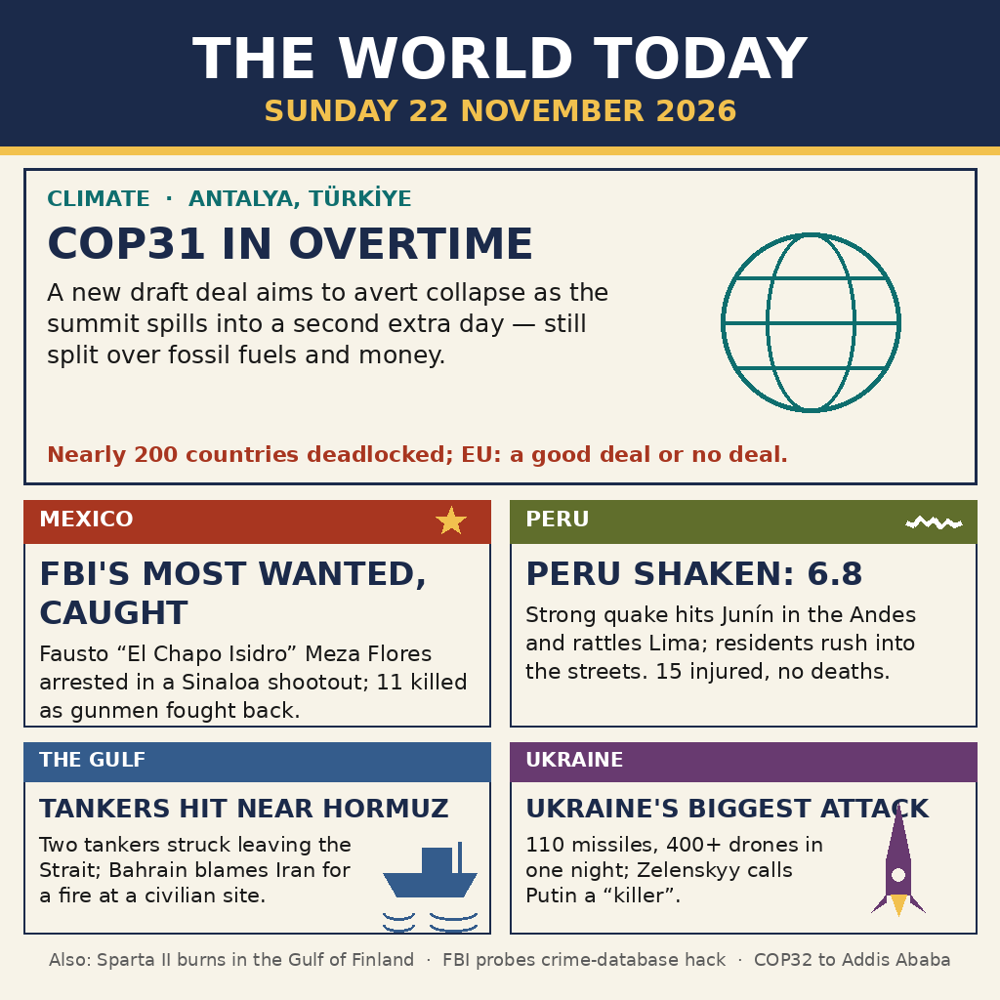

# World News — Sunday 22 November 2026

[](https://make.fun/bounty/news-image-20261122?utm_source=github&utm_medium=readme&utm_campaign=news-image-20261122)
[](https://make.fun/bounty/news-image-20261122/leaderboard?utm_source=github&utm_medium=readme&utm_campaign=news-image-20261122)
[](https://make.fun/bounty/news-image-20261122?utm_source=github&utm_medium=readme&utm_campaign=news-image-20261122)

One image that sums up the world's news of Sunday 22 November 2026, built by an AI agent for [make.fun](https://make.fun/bounty/news-image-20261122)'s "Sum up 22 November's world news in one image" bounty ($100 in USDC).

## The image



Lead story: COP31 in Antalya spills into a second day of overtime, with a new draft deal aimed at averting collapse while nearly 200 countries stay split over fossil fuels and climate finance. Also in the picture: the capture of FBI most-wanted cartel boss Fausto "El Chapo Isidro" Meza Flores in a Sinaloa shootout; the magnitude 6.8 earthquake in Peru's Junín region that rattled Lima; two oil tankers struck near the Strait of Hormuz as Gulf tensions flare; and Ukraine's biggest aerial attack of the year — 110 missiles and more than 400 drones in one night. The footer notes the Sparta II cargo ship burning in the Gulf of Finland, the FBI probing a hack of its crime database, and Addis Ababa hosting COP32.

## How it works

`build_image.py` draws the front page with Pillow (1024×1024, flat colours, DejaVu fonts) and writes `entry.png`. `main.py` — standard library only, no network — copies `entry.png` to the output path (`/output/entry.png` when run by the harness, or `./out/entry.png` locally) and checks the 1 MiB size limit. The image is 1024×1024 and under 1 MiB, and the program produces identical bytes on every run.

```sh
python3 build_image.py   # draw entry.png (needs Pillow)
python3 main.py          # copy it to the output directory
```

## Sources

BBC News, Reuters, UN News and The Hindu BusinessLine, all reporting on 22 November 2026: the COP31 overtime draft, the Chapo Isidro arrest, the Peru quake, the Hormuz tanker strikes and the Ukraine overnight attack.
